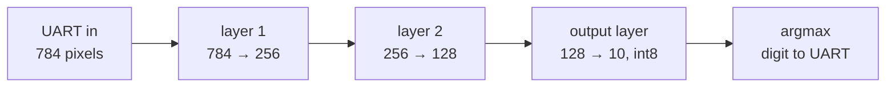
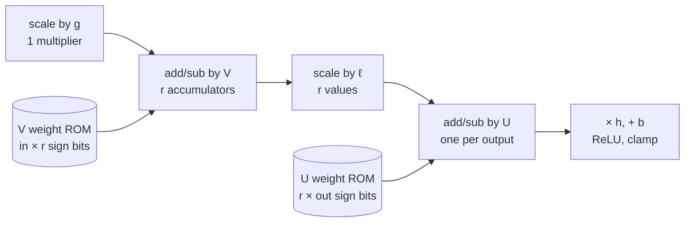

# Project #3: LittleBit × Taalas on a Colorlight i9

Research date for everything below: 2026-11-21, unless a line says otherwise.

A small neural network on the Colorlight i9, with its weights compressed to well under one bit
each and built into the FPGA's logic as constants. It measures what hardwiring low-bit weights buys
and what it costs, on a network small enough to check image by image. Nothing is built yet. It
needs no parts beyond the i9 and an extension board, already ordered for the digitizer
(`lab/sourcing.toml`), and a USB-A port to power them (`scope.md`, "Known part issues").

## What it is for

The point is a chip that runs SocialJax and Concordia as efficiently as possible, to simulate
social conflict and solve it before it happens, and local AI companions in a humanoid robot. Safety
first, and security at the hardware level is very important. (Jon, 2026-11-21.)

What the two run, read from their sources:

- **SocialJax** (cooperativex/SocialJax at 18e2171, Apache-2.0; arXiv 2503.14576) is a suite of
  multi-agent reinforcement-learning environments for sequential social dilemmas, written in JAX.
  Its IPPO baseline's network (`algorithms/utils/networks.py`) is three convolutions of 32 channels
  and a dense layer of 64, then an actor head of 64 that picks one of Clean Up's 9 actions from an
  11 × 11 × 19 observation (`socialjax/environments/cleanup/clean_up.py`). Our count from those
  files: 290,570 parameters with its critic head, 85 % of them in the dense layer, and 286,345 for
  the policy alone. The repo's Clean Up checkpoint is 1,163,141 bytes, the size of 290,570 float32
  numbers and 861 bytes more. That is the same order as this step's 234,752-weight MLP.
- **Concordia** (google-deepmind/concordia at d7da449, Apache-2.0) builds its agents from calls to
  a language model: it "requires access to a standard LLM API", and "You must also provide a text
  embedder for associative memory" (README). Its model registry lists local backends (Ollama,
  Hugging Face, vLLM, Gemma in PyTorch) beside hosted ones, as a search agent read it; not re-read.
  So its compute is language-model inference, the workload Taalas hardwires: its HC1 is "hard-wired
  with Llama 3.1 8B" (taalas.com, "The path to ubiquitous AI", 2026-02-19).

Hardwired weights are constants of the circuit. A chip built this way runs a network that is
already trained: new weights are a new bitstream on the i9, or a new chip in silicon, and training
stays on a computer. So this step tests the inference half: how accuracy, logic and clock speed
move as the bits per weight fall. Whether what it finds carries from a 234,752-weight network to the
ones above is `unknown` until a later step runs one of them.

This step drives nothing but a serial port and an LED. What safety first means for a robot is not
written yet. The rule Tentzhen has so far is the bench's: hard limits live in hardware an AI cannot
reconfigure (`vision.md`, principle 5).

**Security at the hardware level.** Jon names OpenTitan, more for the physical companion
(2026-11-21): "Open source silicon root of trust" (lowRISC/opentitan at 3cc49775, Apache-2.0),
written in SystemVerilog. Its tops are Earl Grey, Darjeeling and English Breakfast, and its FPGA
builds are Earl Grey's for the CW340 board and English Breakfast's for the CW305
(`hw/top_*/chip_*_cw3*.core`). Whether any of its tops fits the i9's LFE5U-45F is not checked, and
it is not part of this step. Tentzhen already has a research track for keys in a TROPIC01 secure
element (`roadmap.md`), and the mesh names an SE050 for its own board (`mesh.md`); whether one part
serves the bench, the mesh and the companion is not weighed. Hardwired weights have one property of
their own here: in silicon they cannot change without a new chip, while on the i9 they change with
the bitstream.

## Where this came from

Jon's spec of 2026-11-21, "LittleBit × Taalas on a Colorlight i9 — Project Spec", written in a
Claude session and brought in the same day. The research questions, the network, the checks, the
experiments and the phases are its. Changed here: the languages follow CLAUDE.md; it builds in this
repo, not a repo of its own; a board run is a measurement record; loading the board follows the
lab-target rules; the spec's open question about the extension board is answered from this repo;
and two bits-per-weight figures, the clock count, the image rate and the preloaded-image count are
worked out again. Phase 5 and research question 5 come from a second Claude session's answer that
Jon brought the same day ("so would i do openroad after the i9?"), kept where its sources were read:
LibreLane's repo and Tiny Tapeout's site.

## Research questions

1. **Quality vs. bits:** how does test accuracy fall as the factor rank r, and so the bits per
   weight, drops, for a fixed network shape?
2. **Same memory, bigger model:** at an equal weight-bit budget, does a wider network at very low
   bits beat a narrower one at higher bits?
3. **Hardwired vs. stored:** for the same weights, how do LUTs, block RAM, maximum clock and latency
   compare when the weights are logic constants (Variant A) and when they are read from block RAM
   (Variant B)?
4. **Hardware fit:** how many binary weights fit in the LFE5U-45F when hardwired, and what runs out
   first: LUTs, routing or timing?
5. **FPGA vs. silicon:** per weight bit, how much area and how many cells does a hardwired layer
   take when laid out as a chip, against the LUTs it takes on the i9?

Out of scope for this step: LLMs, making a chip (Phase 5 lays one out; making one is a stretch
goal), and training on the FPGA. Training runs in PyTorch on a computer; the FPGA only runs
inference.

## Hardware

The design fits one LFE5U-45F and leaves about 30 % of its LUTs free for routing and timing.

| resource | the LFE5U-45F has | budget | used for |
|---|---|---|---|
| LUT4s | 44k | ≤ 30,000 | Variant A's weight ROMs, adders, control, UART |
| block RAM (EBR) | 108 × 18 kbit, 1,944 kbit | ≤ 80 blocks | Variant B's weights, the input image and activation buffers |
| 18 × 18 multipliers | 72 | ≤ 32 | scale vectors and requantization only |
| clock | a 25 MHz oscillator | 50 MHz from the ECP5's PLL | 50 MHz first; higher in E12 |

The chip's figures are Lattice's (FPGA-DS-02012 3.4, Table 1.1; the PDF's sha256 26570f8b…,
read 2026-11-21). The chip is the i9 v7.2's LFE5U-45F-6BG381C (`scope.md`, "Architecture"), so
nextpnr takes `--45k --package CABGA381 --speed 6`. On arrival its JTAG IDCODE tells it from its
siblings without reading the marking: 0x41112043 (`builds/digitizer/v1.toml`, walkthrough).

**The board** is the i9 on any of the three extension boards (`scope.md`, "One i9, three extension
boards"), with nothing wired to the headers. Jon has two i9s, each in an extension board of its
own: his #1 and #2, here i9-1 and i9-2 (2026-11-22). The serial a load logs is the extension
board's probe's, not the i9's, so each i9 stays in its own extension board:

| unit | its probe's serial | port on the lab computer | IDCODE |
|---|---|---|---|
| i9-1 | `07000001006000573800001256313848a5a5a5a597969908` | COM3 | 0x41112043, LFE5U-45: lab log seq 9 of 2026-11-22 |
| i9-2 | `07000001005400333800001256313848a5a5a5a597969908` | COM4 | 0x41112043, LFE5U-45: seq 10 |

Gate 0 ran on i9-1: its loads, seq 2 and 4, name i9-1's probe. Gate 0's records name the part and
its revision, not the unit.

i9-2 has run the same blinky bitstream from SRAM (seq 11), with only its own board plugged in. Jon
saw its green LED blink about once a second (seq 12). It wasn't blinking before the load, as Jon
reported afterwards (seq 13). So the blink began with the load. Gate 0's blinky used a power
cycle as its control; this one uses before and after. What i9-2's flash holds is `unknown`.

**The PLL at 50 MHz.** Gate 0 ran at 25 MHz from the oscillator. The design will run at 50
MHz from the ECP5's PLL (the table above). So before the layer engine, Gate 0's echo and blinky ran
on i9-2 from the PLL at 50 MHz (`gateware/bringup/pll_echo.py`, 2026-11-23). The PLL's dividers are
the ones Project Trellis's `ecppll -i 25 -o 50` gives: 25 MHz, times 2, from a 600 MHz VCO.

| | the result | lab log, 2026-11-23 |
|---|---|---|
| before the load | the 25 MHz blinky, and no echo at 115,200 baud | seq 14, 15 |
| after it, at 115,200 baud | all 282 bytes back, in order, twice | seq 17, 19 |
| after it, at 57,600 baud, the rate it would echo at from 25 MHz | the first byte back already wrong | seq 18 |
| the LED, by eye | about once a second, not once every 2 s | seq 20 |

So the PLL locks, and the design runs near 50 MHz: `measured`, `2026-11-23-i9-pll-echo`. How near
isn't measured. Echoing at 115,200 baud only shows the clock is close enough for the UART. nextpnr
derives the 50 MHz constraint from the PLL's dividers by itself, and puts the routed design's limit
at 155.50 MHz. That is its timing model's figure, not a measurement. That the PLL refuses dividers
outside `ecppll`'s ranges is `tested` (`gateware/cores/tests/test_ecp5_pll.py`). So is the echo at
50 MHz and its divisor, 434, in cocotb without the PLL, which Verilator has no model of
(`uart_echo_at_50_mhz_sends_back_every_byte_at_115200_baud`).

**One layer on the board.** r16's first layer, 784 → 256 at rank 16, ran on i9-2 on the layer
engine at 50 MHz from the PLL (`gateware/bringup/littlebit_layer.py`, 2026-11-23). It answered every
input exactly as the golden model computes it: every y, and every z, the int32 before the shift and
clamp, of all 256 outputs. That is `measured`, `2026-11-23-i9-littlebit-layer`:

| | inputs | answered exactly as the golden model | lab log, 2026-11-23 |
|---|---|---|---|
| before the load (the PLL echo) | 1 frame | none: it came back as an echo | seq 21, 22 |
| the test vectors for the layer | 6 | 6 | seq 24 |
| MNIST's first 1,000 test images, shifted as the network shifts them | 1,000 | 1,000, in 180.0 s | seq 25 |

The computer sends a frame, 0xA5 and the layer's 784 input bytes. The design answers 0x5A and, for
each output, y and z, 1,281 bytes: 180 ms an input at 115,200 baud, the serial link's time, not the
engine's. A frame left part way is dropped after 100 ms of silence. `cargo run -p
tentzhen-littlebit -- layer <port> (vectors | mnist <count>)` is the computer's side
(`crates/littlebit/src/board.rs`). In cocotb, without the PLL and at a UART divisor of 8, the same
design answers two frames as the golden model does and drops a part one
(`gateware/bringup/tests/test_littlebit_layer.py`). Built, it takes 6,422 of nextpnr's logic cells,
2 DP16KD blocks for the outputs' FIFO, and closes at 55.99 MHz; the weights stay logic, as the
Yosys log shows (`littlebit_layer.layer.fifo.storage` is the only memory it maps to block RAM).
This is one layer, not check 3, which takes the whole network's scores and digit.

**Load with one board on USB.** openFPGALoader 1.2.0 can't choose between two identical CMSIS-DAP
v1 probes:

- With both plugged in and no index, it refuses: "more than one CMSIS-DAP v1 device".
- `--cable-index` matches the probe's USB interface number, which is 3 on both, so it opens
  whichever probe the system lists first. In seq 9 that was i9-1's.
- Choosing by serial or by USB bus and device isn't supported for these probes.

That is what 1.2.0 did here, and what its source at master does (`src/cmsisDAP.cpp`, read
2026-11-22). So a load is made with only its own board plugged in. The serial it logs is the one
openFPGALoader reports opening.

The board uses:

- **Clock:** 25 MHz on ball P3. From it the ECP5's PLL, EHXPLLL, makes 50 MHz
  (`gateware/cores/ecp5_pll.py`).
- **LED:** ball L2, lit when driven low; the same ball is P2 pin 28.
- **UART:** balls J17 (out of the FPGA) and H18 (in), wired to the extension board's DAPLink, which
  gives the computer a USB serial port (`builds/digitizer/v1.toml`, its header notes).
- **Loading a bitstream:** openFPGALoader's `colorlight-i9` board, through the DAPLink as a
  CMSIS-DAP cable (openFPGALoader at 2aafd902, `src/board.hpp`). It writes the FPGA's SRAM by
  default, so a bitstream is gone at power-off; `-f` writes the flash (its README, same commit).

The balls are LiteX's for the i9 v7.2 (litex-boards at 53dc2ed0,
`litex_boards/platforms/colorlight_i5.py`, `_io_v7_2`). An Amaranth platform for the i9 exists in
Muse Lab's own repo, `src/amaranth_boards/colorlight_i9_r7_2.py` (wuxx/Colorlight-FPGA-Projects at
016e5889, Apache-2.0): the chip, the 25 MHz clock on P3, the LED on L2, and the headers, with the
UART's balls on its P5 connector and no UART resource of its own. Its comment says "Some of these
still need verifying". Upstream amaranth-boards has no i9 (at f270d210). Ours,
`gateware/boards/colorlight_i9.py`, has the clock, the LED and the UART. On our board the clock and
the LED are `measured` (`2026-11-22-i9-blinky`), and so is the UART, TX on J17 and RX on H18
(`2026-11-22-i9-uart-echo`).

**Loading the board is a flash.** Loading code into a board counts as flashing it, into SRAM too
(`lab/targets.toml`). The i9 is not a lab target, so until a person lists it, every load needs a
person's approval in the session, and every load is logged as a `firmware.flash`.

## Languages and layout

| piece | language | where |
|---|---|---|
| training and the rank sweep | Python, PyTorch: the exception CLAUDE.md names for it | `models/littlebit/` |
| the weight export and the integer golden model | Rust | `crates/littlebit` |
| the layer engine, the output layer, the weight-ROM generator, the whole network | Amaranth | `gateware/cores/littlebit.py` |
| the UART | Amaranth | `gateware/cores/uart.py` |
| the top level: the network behind the UART | Amaranth | `gateware/littlebit/network.py` |
| tests of the gateware | cocotb on Verilator, run by pytest | `gateware/cores/tests/` and `gateware/littlebit/tests/` |
| the host: sends inputs, compares answers | Rust, `tentzhen-littlebit`'s commands | `crates/littlebit` |

Each directory is made when its first real file arrives (`roadmap.md`, Phase 0).

The pieces meet at one file: the exported weights (signs, scales, shifts and biases) as JSON,
`models/littlebit/runs/<run>/integer.json`. The golden model and the ROM generator both read it, so
they cannot read different weights. The golden model also writes out the intermediate vectors and
scores that the cocotb tests compare against.

The export is in Rust, not Python, although it's part of the model work (2026-11-22). It needs no
PyTorch, only a run's committed weights and the training images. In Rust, the Quality Gate
re-runs it and fails if the committed file differs (`r16_integer_json_is_what_the_exporter_writes`).
It also measures each layer's latent shift with the golden model's own arithmetic, so the two can't
disagree about it.

Why these for this project: in Amaranth, the ROM generator is Python that builds the circuit from
the JSON, with no Verilog text to template; Rust makes every integer widening explicit and stops a
test on an overflow, which is what "integer-exact" asks of the golden model; and the host writes the
lab log and the records, which are Rust already.

**Toolchain:** Yosys, nextpnr-ecp5, Project Trellis, Verilator, cocotb and Amaranth, pinned with the
rest (`roadmap.md`, Phase 0), plus PyTorch and openFPGALoader. Until that pinned toolchain exists,
training runs in `models/littlebit/`'s uv environment: Python 3.12.15, PyTorch 2.15.0 (its CUDA
13.2 build on Windows and Linux) and NumPy 2.5.5, every package pinned by its `uv.lock`, and
`every_python_dependency_is_pinned` holds the pins it names. Amaranth's ECP5 platform runs Yosys,
nextpnr-ecp5 and ecppack itself (amaranth at 90449f1e, `amaranth/vendor/_lattice.py`). nextpnr's
`--report` writes a "timing and utilization report in JSON format" (nextpnr at 15b77f5f,
`common/kernel/command.cc`), the source of each run's LUT, EBR and Fmax figures. MNIST is fetched
and checked against a pinned sha256; its terms are not read, so it is not committed. Phase 5 adds
LibreLane, "ASIC implementation flow infrastructure, successor to OpenLane" (Apache-2.0,
librelane/librelane at 8494d4fe), whose README recommends installing it with Nix; Tiny Tapeout's
local-hardening guide runs it in Docker (TinyTapeout/tinytapeout_www at ce1fff22). It runs on
GitHub's computers, in LibreLane's Docker image, as Tiny Tapeout's GDS action does, with the
version and the action pinned, not on the lab computer (Jon, 2026-11-21; `prior-art.md`, "A
chip's layout").

## Model

The baseline is a 784 → 256 → 128 → 10 MLP on MNIST, 234,752 weights. The two hidden layers use
LittleBit-style factorized binary weights. The output layer stays dense int8: it has 1,280 weights.

**Layer math.** Each LittleBit layer replaces its weight matrix W (out × in) with two binary factors
and three scale vectors:

```math
y = h \odot \Big( U_s \big( \ell \odot ( V_s^{\top} ( g \odot x ) ) \big) \Big) + b, \qquad U_s \in \{\pm 1\}^{\text{out} \times r},\; V_s \in \{\pm 1\}^{\text{in} \times r}
```

g (length in), ℓ (length r) and h (length out) are learned scales; b is a bias. Multiplying by U_s
or V_s is only addition and subtraction.

**Bit accounting.** Every run reports both numbers, because at this size the scales are a real
share of the budget:

```math
\text{sign bpw} = \frac{r\,(\text{in} + \text{out})}{\text{in} \cdot \text{out}}, \qquad \text{total bpw} = \frac{r\,(\text{in} + \text{out}) + 8\,(\text{in} + \text{out} + r)}{\text{in} \cdot \text{out}}
```

The 8 is for 8-bit scales; it changes if the export uses 16-bit ones. It is the paper's Eq. 16
without the residual path, and with 8 bits a scale where the paper's are FP16, 16 bits each (arXiv
2506.13771v5, Appendix D). Neither counts the bias, an int32 per output: 8,192 bits on layer 1,
about as many as its signs at r = 8.

**Rank sweep for layer 1** (784 → 256, 200,704 weights):

| rank r | sign bits | sign bpw | total bpw, 8-bit scales |
|---|---|---|---|
| 4 | 4,160 | 0.021 | 0.062 |
| 8 | 8,320 | 0.041 | 0.083 |
| 16 | 16,640 | 0.083 | 0.125 |
| 32 | 33,280 | 0.166 | 0.209 |
| 64 | 66,560 | 0.332 | 0.376 |

`tested`: `the_littlebit_bit_counts_follow_from_the_formula` recomputes this table from the formula,
and the experiments' bits-per-weight column from it, E3's binary row too. Layer 2 (256 → 128) uses
the same r. The baselines have the same shape: dense FP32, dense int8, and plain binary weights
(1 bit per weight, one scale per output).

**Training recipe** (Jon's spec):

1. Train the FP32 MLP (Adam, learning rate 1e-3, cosine decay, about 20 epochs) and record its
   accuracy as the ceiling.
2. Start each LittleBit layer from its FP32 weights: a truncated SVD to rank r, the signs of the
   factors become U_s and V_s, and the magnitudes are folded into g, ℓ and h. The paper's Dual-SVID
   does it this way: a rank-1 approximation of |U′| gives h and one latent scale, one of |V′| gives
   g and another, and ℓ starts as their element-wise product (arXiv 2506.13771v5, section 3.2,
   Eqs. 6–8).
3. Fine-tune with quantization-aware training: sign() in the forward pass, and a straight-through
   estimator in the backward pass (the gradient passed where |w| ≤ 1). About 20 epochs. The paper
   instead uses SmoothSign ("backward gradient: tanh(kx), k = 100"), reporting it better than the
   straight-through estimator, and distils from the full-precision model as teacher (section 4.1,
   Appendix B.2).
4. Fake-quantize activations to uint8 during training (ReLU, then a per-layer power-of-two scale),
   so that the trained model matches the integer hardware.
5. Optional, after the core sweep: the paper's Residual Compensation, which splits the same bit
   budget into two lower-rank paths, the second started on what the first leaves (section 3.3).
   Measure whether two paths beat one at the same bits.

The paper's code (SamsungLabs/LittleBit at 42d658b) is under CC BY-NC 4.0, for non-commercial use
only, so Tentzhen writes its layer from the paper and copies none of that code.

**The first LittleBit run, r = 16** (`models/littlebit/littlebit.py` and `train_rank.py`,
2026-11-22). It runs steps 2–4 from E1's committed weights. Whatever the recipe and the paper
leave open was chosen before the run:

- **Dual-SVID's splits.** The paper doesn't say how W's singular values are shared between U′ and
  V′, or how each rank-one fit is split between its two vectors. Here each side takes the square
  root, both times. U and V start as U′ and V′, as the paper has them.
- **The sign.** +1 where the latent weight is ≥ 0, −1 elsewhere, with step 3's straight-through
  gradient rather than SmoothSign.
- **The input.** Pixels enter as ⌊p / 2⌋ / 128, the 0–127 inputs of "Fixed-point formats".
- **The activations.** Each hidden layer's outputs are uint8 times 2^e: ⌊y / 2^e⌋ clamped to
  0–255, the same as the hardware's shift, ReLU and clamp. Each e is fixed before training: the
  smallest that clamps nothing the started model gives on the training images. That is −5 after
  layer 1 and −4 after layer 2.
- **What stays float.** The scales g, ℓ and h and the output layer stay float in training. The
  exporter makes them integers, and check 1 measures what that costs. At r = 16 it costs nothing
  (Verification, "Check 1 passes at r = 16").
- **The training.** E1's settings: Adam at 1e-3, cosine decay to 0 over 20 epochs, batches of 128,
  seed 0, and cross-entropy on the labels. It doesn't distil from E1, as the paper does.

The run gets 9,713 of the 10,000 test images right, 97.13 %, which is 1.18 points under E1. It also
gets 58,798 of the 60,000 training images. Both counts are `tested` by
`r16_scores_what_its_summary_says`, which re-scores the committed weights
(`models/littlebit/runs/r16`) with the signs and the uint8 grid in its own f32 arithmetic. Three
runs gave the same weights, byte for byte, in about 50 s each on the lab computer's GPU (each
summary's `seconds`).

Before any fine-tuning, the network as Dual-SVID started it got 4,710 test images right. That is
PyTorch's count in the summary, and no test re-checks it. In the summary's curve, the test count
moved between 9,418 and 9,686 over the first 19 epochs, and rose as the learning rate fell to 0.
Whether a smaller learning rate or the paper's distillation would do better is `unknown`. A run
that chooses between them should choose on images held out of the training set, not on the test
images.

**The baselines, E2 and E3** (`models/littlebit/train_baseline.py`, 2026-11-23). They follow r16's
recipe in everything but the hidden layers, so a baseline and a LittleBit run differ only there.
Each starts from E1's committed weights, with pixels as ⌊p / 2⌋ / 128, uint8 activations whose
exponents are fixed before training, E1's training settings and a dense output layer. What
differs was chosen before the runs:

- **E2, int8.** The hidden layers are dense. Their weights stay float in training, as the output
  layer's do, and the exporter makes them int8, each matrix on one power-of-two grid, as it makes
  the output layer's. Check 1 measures what that costs.
- **E3, binary.** Each hidden layer is y = h ⊙ (sign(W) x) + b, with one scale per output. W
  starts as E1's weights, each h as the mean of |W| along its output's row, and b as E1's bias.
  That h is the scale that brings h sign(W) closest to W in squared error. The sign and its
  gradient are r16's.

| run | test images right, float | integer | the same digit, float and integer | training images right, float | activation exponents |
|---|---|---|---|---|---|
| E2, int8 | 9,835 (98.35 %) | 9,833 (98.33 %) | 9,992 | 60,000 | −4, −3 |
| E3, binary | 9,824 (98.24 %) | 9,824 (98.24 %) | 9,991 | 60,000 | −4, −4 |

These counts are `tested`. `e2_scores_what_its_summary_says` and `e3_scores_what_its_summary_says`
re-score the committed weights in f32 (`models/littlebit/runs/e2` and `e3`), and
`e2_and_e3_integer_are_within_half_a_point_of_float` exports them as integers and scores them. So
check 1 holds for both: E2 loses 2 images to its int8 weights, and E3 loses none in all, though
its integer and float models pick different digits on 9 images. Two runs of each gave the same weights, byte for byte, in 24 s (E2) and 38 s (E3) on the
lab computer's GPU.

A baseline runs on the computer only, so its integer network is not written to a file. The test
exports it from the committed weights as it scores it (`export::baseline` in `crates/littlebit`).
E2's hidden weights land on a grid of 2^−7, and E3's scales on one of 2^−9.

What the counts show:

- **E2 in float gets 4 more test images right than E1,** 9,835 against 9,831. Several things
  could explain it: the hardware's pixel and activation grids, 20 more epochs, or chance. Which
  one it is, is `unknown`, since no run separates them.
- **E3, at about 1 bit a weight, is 7 images under E1** and 107 above r16's integer model, which
  has 0.125 bits a weight in layer 1.
- **Both get all 60,000 training images right,** as E1 does. r16 gets 58,798.

Each started where its summary says, before fine-tuning: E2 at 9,828 test images right, E3 at
8,535. Those are PyTorch's counts, and no test re-checks them.

**The rest of the rank sweep, E4, E5, E7 and E8** (`models/littlebit/train_rank.py`, 2026-11-23).
These are r16's run at r = 4, 8, 32 and 64, with nothing else changed, each exported as r16 is:

| run | r | test images right, float | integer | the same digit, float and integer | training images right, float / integer | latents saturated, test images | activation exponents |
|---|---|---|---|---|---|---|---|
| E4 | 4 | 8,802 (88.02 %) | 8,791 (87.91 %) | 9,932 | 52,869 / 52,850 | 1 | −5, −5 |
| E5 | 8 | 9,464 (94.64 %) | 9,463 (94.63 %) | 9,974 | 57,036 / 57,018 | 0 | −5, −5 |
| E6 | 16 | 9,713 (97.13 %) | 9,717 (97.17 %) | 9,980 | 58,798 / 58,809 | 0 | −5, −4 |
| E7 | 32 | 9,772 (97.72 %) | 9,776 (97.76 %) | 9,993 | 59,602 / 59,597 | 0 | −5, −5 |
| E8 | 64 | 9,814 (98.14 %) | 9,815 (98.15 %) | 9,993 | 59,887 / 59,886 | 0 | −4, −5 |

`tested`: `the_sweep_scores_what_its_summaries_say` re-scores each run's committed weights in f32
(`models/littlebit/runs/r4`, `r8`, `r32` and `r64`). `the_sweep_s_integer_json_is_what_the_exporter_writes`
and `the_sweep_s_integer_is_within_half_a_point_of_float` check the exports and their counts. E6's
row is r16's, from the tests above. Two runs at each rank gave the same weights, byte for byte, in
about a minute each.

What the counts show:

- **Check 1 holds at every rank.** The largest loss from float to integer is E4's, 11 images.
- **Accuracy falls fast below r = 16.** As integers, r = 8 gets 254 fewer test images right than
  r = 16, and r = 4 gets 926 fewer. This is the plan's first risk, "accuracy collapses at low r"
  (Risks). Whether residual compensation or the paper's distillation would hold it up is
  `unknown`: neither has run.
- **Above r = 16 it gains slowly.** In float, r = 64, at 0.376 bits a weight in layer 1, gets 17
  fewer images right than E1. E3, at 1.010 bits, gets 7 fewer.
- **One latent saturates at r = 4, on one test image.** The latent shift is chosen so that none
  saturates on the training images. On the test images, this one did.

Before fine-tuning, Dual-SVID's starts got 2,906, 4,164, 5,282 and 5,303 test images right at
r = 4, 8, 32 and 64. Those are PyTorch's counts, and no test re-checks them.

**Fixed-point formats,** fixed at export and the same in the golden model and the gateware:

- Input pixels: uint8, 0–255 scaled to 0–127.
- Scales g, ℓ and h: int8, with one power-of-two shift per vector. Bias: int32.
- Accumulators: int32 everywhere (784 terms of int16 need at most 26 bits).
- The ℓ-scaled latents: each V sum times its int8 ℓ, a product of at most 33 bits, then an
  arithmetic right shift by the layer's latent shift, saturated to int16.
- Between layers: arithmetic right shift, ReLU, clamp to uint8.
- The output layer's weights: int8, with one power-of-two shift for the whole matrix.
- Output: 10 int32 scores. The predicted digit is their argmax, computed on the FPGA.

Every right shift is arithmetic, so it rounds toward minus infinity, and nothing rounds to nearest
while the network runs. The exporter rounds to nearest only once, when it turns the float weights
into integers. The golden model follows these steps in `crates/littlebit/src/integer.rs`, and
`a_littlebit_layer_computes_what_its_steps_say` works one small layer by hand against it.

How the exporter chooses each value (`crates/littlebit/src/export.rs`):

- **Scales and output weights.** Each vector, or the output matrix, gets the finest power-of-two
  grid that holds its largest value in 127 steps
  (`int8_takes_the_finest_grid_that_holds_the_largest`).
- **Latent shifts.** Each layer's is the smallest that saturates no latent on the 60,000 training
  images (`r16_integer_saturates_no_latent_on_the_training_images`). At r = 16 that is 10 for
  layer 1 and 9 for layer 2. No latent saturates on the test images either
  (`r16_integer_is_within_half_a_point_of_float`).
- **Output shifts.** These put each layer's outputs on the grid it trained on, so an output is
  ⌊y / 2^e⌋ clamped to 0–255, as in training.

A layer's exponents add up to that grid, and `Network::parse` refuses a file where they don't
(`an_integer_network_refuses_what_does_not_fit`). At r = 16, layer 1's add up to −5:

- pixels −7
- g −8
- ℓ −7
- latent shift +10
- h −8
- output shift +15

The 33-bit ℓ product is wider than one of the ECP5's 18 × 18 multipliers takes. How the gateware
forms it is Phase 2's to decide.

## Hardware architecture

The design is time-multiplexed: each LittleBit layer takes one input per clock and updates all its
accumulators at once. That keeps the adders small. Between runs at one rank only the weight ROMs,
the thing being studied, change; a new rank also changes how many accumulators the V stage has.



Layers 1 and 2 each get a LittleBit engine of their own, so they run as a pipeline. The output layer
uses 10 multipliers at once, one per digit: each input, one a clock, is multiplied by its column of
the weights and added into 10 accumulators that start from the biases. Then the argmax reads the
10 scores one a clock and keeps the first of the highest, as the golden model does
(`DenseEngine` and `LittleBitNetwork` in `gateware/cores/littlebit.py`). One engine:



The two weight ROMs are what the experiments change. In Variant A they are logic constants
generated from the trained weights; in Variant B the same bits sit in block RAM.

**Per-layer schedule** (r = rank), as the engine runs it (`gateware/cores/littlebit.py`):

1. Scale by g, then add or subtract by V: one input per clock for `in` clocks, and one more. Each
   input's row of V (r sign bits) adds it into, or subtracts it from, r accumulators.
2. Scale by ℓ: one latent per clock for r clocks, each shifted, saturated to int16 and kept.
3. Add or subtract by U, scale by h, add the bias, ReLU, clamp to uint8: one output per clock for
   `out` clocks. Each clock reads one row of U (r sign bits) and sums the r latents by it in one
   adder tree, then one multiplier scales the sum.

The plan first had stage 2 read U's columns and update `out` accumulators at once. Synthesized for
r16's first layer, those 256 accumulators came to 18,778 LUT4s and 3,106 carry cells (Yosys, OSS
CAD Suite 2026-11-21, 2026-11-23): more than both layers' budget. Summing each output's r latents
in stage 3 instead brought the layer to 5,973 of nextpnr's logic cells. Each stage also keeps its
values for a clock between reading a ROM and the arithmetic after it. Without those registers,
nextpnr's first routes of the two layers reached 40.72 and 44.80 MHz, short of 50.

**Clocks per image.** The engine takes in + r + out + 1 clocks a vector, and its last output comes
2 clocks after that. With inputs back to back, that is `tested`: 1,057 clocks for r16's layer 1
and 401 for its layer 2 (`littlebit_engine_computes_r16_layer_1_as_the_golden_model_does`,
`littlebit_engine_computes_r16_layer_2_as_the_golden_model_does`). Run one after another, the
three layers would take 1,554 + 2r clocks. The network overlaps them instead. Each engine hands
its outputs to the next as it makes them, one a clock, and the next takes them as they come:

- Layer 2 takes its first input 784 + 1 + r + 3 clocks after layer 1 takes the first pixel.
- The output layer takes its first input 256 + 1 + r + 3 clocks after that.
- It then takes its 128 inputs, adds the last a clock later, and runs the argmax in 10.

That makes 1,187 + 2r clocks from the first pixel to the digit: 1,219 at r = 16, 24.4 µs at
50 MHz. It is `tested` as both the design's cycle counter and the test count it
(`littlebit_network_scores_r16s_test_vectors_as_the_golden_model_does`). The spec estimated
1,550 + 4r. On the board the counter reported 1,219 for each of the 1,006 images it was sent,
`measured`, `2026-11-23-i9-littlebit-network`. At exactly 50 MHz that is 24.38 µs, or 41,017
images a second if the link kept up. The PLL's clock is `measured` only as close enough to 50 MHz
for the UART at 115,200 baud (`2026-11-23-i9-pll-echo`), not to how many places.

**The serial link sets the pace.** At 115,200 baud and 10 bits a byte (8N1, assumed), the 785-byte
request takes 68.1 ms and the 46-byte reply 4.0 ms: at most 13.9 images a second, however fast the
network is. So each run reports two speeds, compute from the cycle counter and end to end. End to
end, the board run managed 13.73 images a second, 1,000 images in 72.8 s, `measured`,
`2026-11-23-i9-littlebit-network`. The DAPLink's top baud rate is `unknown`.

For a throughput test that leaves the link out, the spec preloaded 512 test images into block RAM.
They do not fit: 512 images take 401,408 bytes, and all 108 blocks hold 248,832 (1,944 kbit), so
fewer than 318 images would fit with nothing else in block RAM. The i9's 8 MB of SDRAM (`scope.md`)
or its 8 MB W25Q64 flash (the Amaranth platform above) hold 512, behind a controller this design
does not have yet.

**UART protocol**

| direction | bytes | contents |
|---|---|---|
| computer → FPGA | 1 + 784 | header 0xA5, then 784 uint8 pixels as MNIST stores them; the FPGA shifts them |
| FPGA → computer | 1 + 40 + 1 + 4 | header 0x5A, 10 int32 scores (little-endian), the argmax digit, the cycle count (uint32, little-endian) |

The top level, `gateware/littlebit/network.py`, keeps a frame's pixels in a FIFO until the last one
arrives. Then it feeds them to the network back to back, so the cycle count covers the network
alone, not the serial link. A frame left part way is dropped after 100 ms of silence, as the one
layer's was. In cocotb, without the PLL and at a UART divisor of 8, it answers two frames as the
golden model does, each in 1,219 clocks, and drops a part one
(`gateware/littlebit/tests/test_network_over_uart.py`). `cargo run -p tentzhen-littlebit --
network <port> (vectors | mnist <count>)` is the computer's side (`crates/littlebit/src/board.rs`):
it sends each image as a frame, checks each answer's scores and digit against the golden model's,
and reports the clocks the network counted.

**Variant A and Variant B in Amaranth**

- **A, hardwired:** the generator, `ROM` in `gateware/cores/littlebit.py`, builds each ROM as a
  tree of 2:1 multiplexers on the constant rows, one level per bit of the row index. Yosys turns it
  into LUT logic, so the weights become part of the circuit. The plan had a `Switch` over the row
  index with a constant on each `Case`. But Yosys's `proc_rom` pass turns such a `Switch` into a
  memory, and once the engine registered a ROM's output, `synth_ecp5` put layer 1's ROMs in 4
  DP16KD blocks of block RAM: Variant B, not A. A tree of multiplexers is no `Switch`, and gave no
  block RAM.
- **B, stored:** the same bits are the initial contents of an Amaranth memory, which Yosys maps to
  block RAM. The synthesis log shows whether it landed in EBR. Not written yet.

**What the engines cost.** nextpnr's report for each of r16's two engines alone, at 50 MHz
(OSS CAD Suite 2026-11-21, seed 1; `python -m gateware.cores.littlebit` writes one as Verilog,
2026-11-23):

| r16 | logic cells (TRELLIS_COMB) | flip-flops | 18 × 18 multipliers | block RAM | Fmax after routing |
|---|---|---|---|---|---|
| layer 1, 784 → 256 | 5,973 | 1,093 | 5 | 0 | 58.64 MHz |
| layer 2, 256 → 128 | 4,236 | 1,055 | 5 | 0 | 60.12 MHz |

Those are the toolchain's figures, `trusted` with it (`trusted-base.toml`, `fpga-toolchain`), and
the engines alone, with no UART, output layer or top level. Together they take 10,209 of the
30,000 cells Gate 2 allows. The spec estimated layer 1's U-stage accumulators at a few thousand
LUTs, and the hardwired ROMs at about 1,000–1,500.

**What the whole network costs.** The board's design: r16's two engines, its output layer, the
argmax, the cycle counter, the pixel FIFO, the UART, the blinky and the PLL
(`python -m gateware.littlebit.network <build-dir>`, OSS CAD Suite 2026-11-21, 2026-11-23).
nextpnr reports:

| r16, the board's design | logic cells (TRELLIS_COMB) | flip-flops | 18 × 18 multipliers | block RAM | Fmax after routing |
|---|---|---|---|---|---|
| `littlebit_network` | 12,640 | 3,050 | 20 | 1 DP16KD | 55.63 MHz |

That is within Gate 2's 30,000 at 50 MHz, `trusted` with the toolchain (`fpga-toolchain`). The one
DP16KD is the pixel FIFO. The Yosys log maps one memory to block RAM,
`littlebit_network.network.pixels.storage`, so the weights stay logic. The bitstream's sha256 is
754c51aef2aabe3598296aacbada86a962afd274002b39c0ab929c387d52047b. Rebuilt from main at 34dedf8,
it came out the same, byte for byte, and that is the bitstream check 3 ran on (Verification,
"Check 3 passes at r = 16").

**What each rank costs.** Each rank of the sweep is the same board design built from its own
integer network (`python -m gateware.littlebit.network <build-dir>
models/littlebit/runs/r<r>/integer.json`, OSS CAD Suite 2026-11-21, 2026-11-23). r16, built the
same way on this branch, came out as the bitstream above, byte for byte. nextpnr reports:

| run | r | logic cells (TRELLIS_COMB) | flip-flops | 18 × 18 multipliers | block RAM | Fmax after routing | bitstream's sha256 |
|---|---|---|---|---|---|---|---|
| E4 | 4 | 6,889 | 1,616 | 18 | 1 DP16KD | 55.27 MHz | `ed3d189e…` |
| E5 | 8 | 8,939 | 2,086 | 20 | 1 DP16KD | 50.06 MHz | `b41e697e…` |
| E6 | 16 | 12,640 | 3,050 | 20 | 1 DP16KD | 55.63 MHz | `754c51ae…` |
| E7 | 32 | 20,172 | 4,973 | 20 | 1 DP16KD | 50.43 MHz | `1b92ff46…` |
| E8 | 64 | 35,139 | 8,815 | 20 | 1 DP16KD | 49.55 MHz, short of 50 | none to load |

These are the toolchain's figures, `trusted` with it (`fpga-toolchain`). None of these bitstreams
but r16's has been loaded onto a board. What they show:

- **The logic grows with the rank, about linearly.** Across the five builds, each step of r adds
  about 470 cells, on top of about 5,000 for the rest: (35,139 − 6,889) / (64 − 4) = 471. That's
  arithmetic on these five figures, not a model of the logic.
- **E8 doesn't fit the plan.** At r = 64, its 35,139 cells are over the 30,000 that Gate 2 allows,
  though they're 80 % of the chip's 43,848, so the chip isn't full. Its route also misses 50 MHz,
  at 49.55. nextpnr stops with an error when a clock is missed. A bitstream packed from its
  output anyway is not one to load, and none is kept.
- **So, for research question 4,** at r = 64 timing runs out before the chip's logic does, and
  routing completes. The largest rank that fits, E11, is r = 42 ("E11, the largest rank that
  fits", below).
- **Two ranks only just close.** r = 8 reaches 50.06 MHz and r = 32 reaches 50.43, slower than
  r = 4 and r = 16. Why is `unknown`. nextpnr's placement is a seeded search, and each build ran
  at its default seed.
- **E4 uses 18 multipliers, and the rest 20.** Why is `unknown` too.

The clocks an image are the cocotb test's: each rank's network scores its six test images as its
golden model does, in 1,187 + 2r clocks, which is 1,195, 1,203, 1,251 and 1,315
(`littlebit_network_scores_the_sweep_s_test_vectors_as_the_golden_model_does`). That test runs
r16's six images through each network. Only r16 has run all 10,000 MNIST test images in cocotb
(check 2) and 1,000 on the board (check 3).

**E11, the largest rank that fits** (2026-11-23). "Fits" means the whole board design places,
routes and closes at 50 MHz in nextpnr, at its default seed, as the experiments table has it.
How to search was fixed before the first build:

1. Raise r from 32, which fit, in steps of 8, to the first rank that doesn't.
2. Then bisect between the last that fit and the first that didn't, down to a step of 1.
3. Train each rank tried as the sweep's were, export it, check it, and build it once.

r = 56 was built alongside 40 and 48, before the bisection. It isn't part of the search, and
its build didn't finish. nextpnr's router was still running 32 minutes in, and was stopped. For
comparison, r = 64's whole build took 11 minutes alone, while r = 56 shared the computer with
other builds for part of its time. Whether r = 56 routes at this seed is `unknown`. Its
accuracy is in the sweep's tests: 9,794 test images right as integers, 9,795 in float.

| r | test images right, integer (float) | logic cells | flip-flops | Fmax after routing | |
|---|---|---|---|---|---|
| 32 | 9,776 (9,772) | 20,172 | 4,973 | 50.43 MHz | fits (E7) |
| 40 | 9,771 (9,771) | 23,915 | 5,936 | 51.34 MHz | fits |
| 48 | 9,791 (9,792) | 27,266 | 6,895 | 49.11 MHz | misses 50 MHz |
| 44 | 9,803 (9,803) | 25,429 | 6,417 | 47.35 MHz | misses |
| 42 | 9,795 (9,796) | 24,934 | 6,174 | 50.29 MHz | **fits: E11** |
| 43 | 9,805 (9,802) | 25,326 | 6,296 | 49.68 MHz | misses |

The rows are in the order the search built them. Each design took 20 of the 18 × 18 multipliers
and 1 DP16KD, the pixel FIFO, and each routed. So E11 is r = 42: the largest rank this search
found that fits, with r = 43 the smallest that doesn't. r = 42's bitstream is `e55ea4b7…`, and
no board has run it. The test counts are `tested`, by the sweep's tests above, which take in
every rank committed here. The build figures are nextpnr's, `trusted` (`fpga-toolchain`).

What it answers:

- **Research question 4, what runs out first: timing.** At r = 42, 24,934 cells are 57 % of the
  chip, within Gate 2's 30,000 budget. Every design the search built routed, and so did
  r = 64's. The 50 MHz clock is what stops the rank rising.
- **How many binary weights fit:** at r = 42 the two hidden layers hold 42 × (784 + 256) +
  42 × (256 + 128) = 59,808 sign bits. They stand for the hidden layers' 233,472 weights, at 0.261
  total bits a weight in layer 1.
- **The boundary is not sharp.** Fmax doesn't fall steadily with r: r = 40 closes at 51.34 MHz,
  r = 44 misses at 47.35, and r = 8 and r = 32 only just close. Each figure is one route at one
  seed, so another seed could move the line by a rank or more. Whether a rank above 42 would
  close at another seed is `unknown`. E12, the clock push, is the experiment that varies the
  clock.
- **Accuracy has flattened by here.** From r = 40 to r = 48, the integer models get 9,771 to
  9,805 test images right, against r = 64's 9,815 and E1's 9,831 in float.

Like the sweep's, the search ranks are committed (`models/littlebit/runs/r40` to `r56`) and
held by the same tests. r = 42 also has a network case in the test vectors, and cocotb runs it
like the sweep's: 1,271 clocks an image
(`littlebit_network_scores_the_sweep_s_test_vectors_as_the_golden_model_does`).

## Verification

Every stage must match the integer golden model bit for bit; accuracy is compared only at the step
from float to integer. Four models, three checks:

| check | compares | passes when | its grade |
|---|---|---|---|
| 1. quantization gap | the PyTorch float model vs. the Rust integer golden model | accuracy drops ≤ 0.5 points on the 10,000 MNIST test images | `tested` |
| 2. the gateware | the golden model vs. Verilator, through cocotb | all 10 scores identical on all 10,000 test images | `tested` |
| 3. the board | the golden model vs. the i9 over UART | the same digit and scores on at least 1,000 images | `measured` |

**Check 1 passes at r = 16** (2026-11-22). Run from `models/littlebit/runs/r16/integer.json`, the
integer golden model gets 9,717 of the 10,000 test images right. That is 4 more than the float
model's 9,713, not fewer, and the two pick the same digit on 9,980 of the images. On the training
images the integer model gets 58,809 right, against the float model's 58,798. Both are `tested`, by
`r16_integer_is_within_half_a_point_of_float` and
`r16_integer_saturates_no_latent_on_the_training_images`. So 8-bit scales were enough at this rank.

**Check 2 passes at r = 16** (2026-11-23). On Verilator, the network's gateware (`LittleBitNetwork`)
scored all 10,000 MNIST test images exactly as the golden model does: every one of the 10 scores,
and the digit. Each image took 1,219 clocks. That is `tested`, by
`littlebit_network_scores_mnist_test_images_as_the_golden_model_does`, which the Quality Gate runs
on every commit. In the gate it takes 356 s of real time for the 10,000 images. With nextpnr's
12,640 logic cells at 55.63 MHz (What the whole network costs), Gate 2 passes.

**Check 3 passes at r = 16** (2026-11-23). On i9-2, at 50 MHz from the PLL, the whole network
(`gateware/littlebit/network.py`) scored MNIST's first 1,000 test images exactly as the golden
model does: every one of the 10 scores, and the digit. The network counted 1,219 clocks for every
image. That is `measured`, `2026-11-23-i9-littlebit-network`, so Gate 3 passes:

| | images | scored exactly as the golden model | lab log, 2026-11-23 |
|---|---|---|---|
| before the load (r16's first layer), the network's test vectors | 6 frames | none: the host command refused image 1's answer, which started 0x01 | seq 26 |
| the network's test vectors for r16 | 6 | 6, 1,219 clocks each | seq 28 |
| MNIST's first 1,000 test images, as MNIST stores them | 1,000 | 1,000, 1,219 clocks each, in 72.8 s | seq 29 |

974 of the board's 1,000 digits are MNIST's labels. The golden model gets the same 974 by
construction, since the scores are identical. Which bytes the host command read before the load
is `unknown`: the layer design answers 1,281 bytes a frame, and the command reads 46.

What each figure of a run rests on: its accuracy is computed on the host, so `tested` at best; its
LUTs, EBR blocks and Fmax are nextpnr's, `trusted` with the toolchain (`trusted-base.toml`,
`fpga-toolchain`); its images per second and cycle counts are `measured`. Each board run is a
measurement record, `lab/records/<id>.toml` (CLAUDE.md, "Conventions"), in place of the spec's
`results/runs.csv`. The record's gateware hash covers the weights in both variants, since both are
inside the bitstream.

**The golden model**

- Written in Rust with explicit integer types (i8, i32) and the same shift and rounding steps as the
  gateware: an arithmetic right shift (Rust's `>>` on a signed integer), and no rounding to nearest
  unless the gateware rounds too.
- It reads the same exported JSON the ROM generator reads.
- It gives every intermediate vector for one image, after g, V, ℓ, U and h (`integer::Trace`), to
  find a mismatch layer by layer. It writes them out for the cocotb tests:
  `cargo run -p tentzhen-littlebit -- vectors` writes `gateware/cores/tests/littlebit_vectors.json`
  (`crates/littlebit/src/vectors.rs`), and `littlebit_vectors_are_what_the_golden_model_writes`
  fails if the committed file is not what it writes. No MNIST image is in them, since MNIST's files
  are never committed: the inputs are drawn from a fixed seed.
- For a convolution, it takes the window around each position of the grid, with zeros past the
  edge, as Flax's default "same" padding does (`integer::windows`; `tested` by
  `windows_take_each_position_s_patch_with_zeros_past_the_edge`).

**cocotb tests**

- Unit tests per block: UART loopback, one accumulator bank, one weight-ROM read against its
  exported column. The UART's are written (`gateware/cores/tests/test_uart.py`), with one of the
  board's echo design (`gateware/bringup/tests/test_uart_echo.py`). So is the ROM read, of r16
  layer 1's V and U (`littlebit_sign_roms_read_back_r16_layer_1s_v_rows_and_u_columns`). The
  accumulator bank has no test of its own: the layer tests check its sums through every output.
  `docs/architecture.md`, "Rules", lists them.
- A layer test: one LittleBit layer alone against the golden model. Written
  (`gateware/cores/tests/test_littlebit.py`), on r16's two hidden layers, each given all zeros, all
  at the top of its range, and 4 random vectors, back to back. It also runs on a small convolution:
  a made-up 3 × 3 layer from 2 channels to 4 at rank 3, given the 25 windows of a 5 × 5 grid with
  gaps between inputs. Every output's y and z must be the golden model's, and every case
  saturates some latents and clamps some outputs at each end. The engine takes the windows as the
  golden model builds them; gateware that builds them from a grid is not written yet.
- An output-layer test: r16's output layer alone against the golden model, given all zeros, all
  255 and 4 random inputs. A made-up layer from 4 inputs to 5 is tested too: its scores reach both
  ends of an int32, and some tie, so the argmax must pick the first of the highest
  (`gateware/cores/tests/test_littlebit_network.py`).
- A full-network test: r16 against the golden model, every score and the digit of each image, on
  its test vectors and on all 10,000 MNIST test images, in the same file. The plan asked for 100
  images on every commit and all 10,000 before any board run. The gate runs all 10,000 on every
  commit. MNIST is never committed, so the golden model scores the images as the test runs, into
  the test's own temporary folder (`cargo run -p tentzhen-littlebit -- mnist-vectors <count>
  <file>`). The sweep's other networks, r4, r8, r32 and r64, are each given r16's six test images,
  and checked for every score, the digit and 1,187 + 2r clocks an image
  (`littlebit_network_scores_the_sweep_s_test_vectors_as_the_golden_model_does`). A top-level test
  sends r16 frames over the UART
  (`gateware/littlebit/tests/test_network_over_uart.py`).
- Waveforms (FST) kept only for failing tests.

**On the board:** the host command sends each image, reads back the 10 scores and the argmax, and
logs any mismatch with the image's index. It also times round trips, for images per second.

**Grading a training run** (decided by Claude at Jon's request, 2026-11-22). A run's weights and
summary are committed, in `models/littlebit/runs/<run>/`: `weights.f32`, every parameter as
little-endian float32, and `summary.json`, what was run and what it scored, with the weights'
sha256. A Rust test in `crates/littlebit` re-scores the committed weights with its own arithmetic
and checks the summary's counts, on MNIST the Quality Gate fetches and the test refuses unless
each file is its pin (`models/littlebit/mnist.toml`). The gate does not retrain: GitHub's runners
have no GPU, and a GPU's and a CPU's float products differ, so a retrain there would grade another
model. Weights are committed because a grade must be re-checkable, and because rebuilding a run's
bitstream needs them; they are small (E1's are 0.9 MB). Gateware tests stay cocotb, as the language
policy has them, and a cocotb test is a referent as a Rust test is, named `gateware <name>`:
`a_code_referent_names_code_that_exists` finds them, and the Quality Gate runs them on Verilator
from OSS CAD Suite's Linux build of 2026-11-21, the lab computer's day. A Rust test wrapping
cocotb's results would only add a layer.

## Milestones

Six phases, in order. Each ends on a gate that passes before the next starts. There are no dates.
Phase 0 may run beside Phase 1: it needs only the board and the toolchain.

1. **Phase 0, bring-up.** The toolchain (Open questions), the i9's Amaranth platform, a blinky, then
   a UART echo at 115,200 baud, each load approved and logged. **Gate 0:** the LED blinks, and bytes
   from the computer echo back.
2. **Phase 1, the model on the computer.** Train E1–E3 and the LittleBit sweep; write the golden
   model and the exporter. **Gate 1:** check 1 at r = 16, the integer model within 0.5 points of
   float. Check 1 passed on 2026-11-22 (Verification). E2 and E3 ran on 2026-11-23 (Model, "The
   baselines, E2 and E3"), and so did the sweep's other ranks, 4, 8, 32 and 64 ("The rest of the
   rank sweep").
3. **Phase 2, gateware and simulation.** The weight-ROM generator, the layer engine and the top
   level; cocotb on Verilator. **Gate 2:** check 2, bit-exact on all 10,000 test images, and at most
   30,000 LUTs at 50 MHz in nextpnr's report. The network's first board run waits for this gate.
   Two smaller board runs come before it, by Jon's choice (2026-11-22). The first is the PLL at
   50 MHz, done (The board). The second is one layer from the engine, checked against the golden
   model: r16's first layer, done (The board, "One layer on the board"). Gate 2 passed at r = 16
   on 2026-11-23 (Verification, "Check 2 passes at r = 16").
4. **Phase 3, on the board.** Load E6 (r = 16, Variant A), run the host command, read the cycle
   counts. **Gate 3:** check 3, 1,000 images identical to the golden model. Gate 3 passed at
   r = 16 on 2026-11-23 (Verification, "Check 3 passes at r = 16").
5. **Phase 4, experiments and write-up.** Run E1–E12, fill the results table, plot accuracy vs.
   bits per weight and LUTs vs. bits. **Gate 4:** the table is full, and both plots are made.
6. **Phase 5, a chip's layout, with no chip made.** The largest hardwired LittleBit layer that fits
   one Tiny Tapeout tile, laid out with LibreLane. Its Classic flow takes Verilog, which Amaranth
   emits, and runs Yosys's synthesis and OpenROAD's placement and routing
   (`librelane/flows/classic.py`) for a standard-cell process (`sky130A` in its README's example).
   The ECP5's own blocks go: no PLL, block RAM or multipliers, so it is Variant A only, and the
   cocotb layer test runs against the Verilog it lays out. A tile is "about 160x100 um", "enough for
   about 1000 digital logic gates" (Tiny Tapeout's FAQ, of its runs TT04 to TT10; a sky130A tile is
   now 161.00 × 111.52 µm, `prior-art.md`, "A chip's layout"), with 8 inputs, 8 outputs and 8 bidirectional pins besides the clock and reset
   (same FAQ), so the layer takes its inputs a few bits at a time. It costs nothing. Its figures
   rest on LibreLane, OpenROAD and the process kit, which `trusted-base.toml` does not list yet.
   **Gate 5:** LibreLane finishes the layer with its own checks passing, and its cells and area per
   weight bit stand beside the i9's LUTs per weight bit (research question 5).

Gate 0's echo goes through the same DAPLink serial port as the bench's Phase 1 "hello" over UART
(`roadmap.md`), so whichever runs first settles those pins for both. Gate 0 ran first
(`2026-11-22-i9-uart-echo`).

**First steps**

- [x] Read the i9's IDCODE on arrival (`builds/digitizer/v1.toml`): 0x41112043, lab log seq 1 of
  2026-11-22. Its incoming-QA record is not written yet.
- [ ] Settle where the toolchain runs (Open questions).
- [x] Write the i9's Amaranth platform: the clock, the LED and the UART, from the balls above
  (`gateware/boards/colorlight_i9.py`).
- [x] Blinky, then the UART echo (Gate 0): `2026-11-22-i9-blinky` and `2026-11-22-i9-uart-echo`.
- [x] Train the E1 FP32 baseline and save it (`models/littlebit/e1_fp32.py`, 2026-11-22): 9,831 of
  the 10,000 test images, 98.31 %, `tested` by `e1_scores_what_its_summary_says`, which re-scores
  the committed weights (`models/littlebit/runs/e1`). Six runs gave the same weights, byte for
  byte.
- [x] Write the LittleBit layer in PyTorch and run r = 16 (`models/littlebit/littlebit.py` and
  `train_rank.py`, 2026-11-22): 9,713 of the 10,000 test images, 97.13 %, in float, `tested` by
  `r16_scores_what_its_summary_says`, which re-scores the committed weights
  (`models/littlebit/runs/r16`).
- [x] Write the exporter and the integer golden model, then run check 1 at r = 16 (Gate 1)
  (`crates/littlebit`, 2026-11-22): 9,717 of the 10,000 test images, 97.17 %, against the float
  model's 97.13 %, `tested` by `r16_integer_is_within_half_a_point_of_float`.
- [x] Run Gate 0's echo and blinky at 50 MHz from the PLL (`gateware/bringup/pll_echo.py`,
  2026-11-23): `measured`, `2026-11-23-i9-pll-echo`.
- [x] Write the layer engine and the weight-ROM generator, and test them against the golden model in
  cocotb, a small convolution among the tests (`gateware/cores/littlebit.py`, 2026-11-23):
  `tested` by the layer tests above.
- [x] Run one layer from the engine on the board, ahead of Gate 2
  (`gateware/bringup/littlebit_layer.py`, 2026-11-23): r16's first layer answered 1,000 MNIST test
  images exactly as the golden model, `measured`, `2026-11-23-i9-littlebit-layer`.
- [x] Write the output layer, the whole network, its top level over the UART and the full-network
  test, then pass Gate 2 (`gateware/cores/littlebit.py`, `gateware/littlebit/network.py`,
  2026-11-23). The network scored all 10,000 test images exactly as the golden model, `tested` by
  `littlebit_network_scores_mnist_test_images_as_the_golden_model_does`. nextpnr reports 12,640
  logic cells at 55.63 MHz.
- [x] Write the host command for the network's frames, then run the network on the board (Gate 3)
  (`crates/littlebit/src/board.rs`, 2026-11-23): it scored 1,000 MNIST test images exactly as the
  golden model, 1,219 clocks each, `measured`, `2026-11-23-i9-littlebit-network`. Next, Phase 4:
  the experiments, E2 to E12.
- [x] Train the baselines E2 (int8) and E3 (binary, one scale per output), and export them as
  integers (`models/littlebit/train_baseline.py`, 2026-11-23). E2 got 9,833 of the 10,000 test
  images right as integers (9,835 in float). E3 got 9,824 both ways. Both are `tested` by
  `e2_and_e3_integer_are_within_half_a_point_of_float`.
- [x] Run the sweep's other ranks, E4, E5, E7 and E8, export them and build each for the board
  (`models/littlebit/train_rank.py` and `gateware/littlebit/network.py`, 2026-11-23). Check 1
  holds at every rank, `tested` by `the_sweep_s_integer_is_within_half_a_point_of_float`. r = 4
  falls to 87.91 % as integers. r = 64 misses both 50 MHz in nextpnr and Gate 2's cell budget
  (Hardware architecture, "What each rank costs").
- [x] Find the largest rank that fits, E11, by raising r from 32 and then bisecting
  (2026-11-23): r = 42 closes at 50.29 MHz in nextpnr, and r = 43 misses, at 49.68 (Hardware
  architecture, "E11, the largest rank that fits"). Next: E9, Variant B; E10, the wider
  network; and E12, the clock push.

## Experiments

Twelve runs answer research questions 1–4: E1–E3 set the baselines, E4–E8 sweep the rank, E9
compares hardwired and stored, and E10–E12 test the budget and the fit. Question 5 is Phase 5's.
Each cell fills as its run finishes, from the run's record or test.

| run | model (784 → 256 → 128 → 10 unless noted) | variant | layer-1 total bpw | integer test acc (%) | LUTs | EBR blocks | Fmax (MHz) | images/s | status |
|---|---|---|---|---|---|---|---|---|---|
| E1 | FP32 dense (the ceiling) | computer only | 32 | 98.31 (float) | | | | | done |
| E2 | int8 dense | computer only | 8 | 98.33 (float 98.35) | — | — | — | — | done |
| E3 | binary dense, one scale per output | computer only | 1.010 | 98.24 (float 98.24) | — | — | — | — | done |
| E4 | LittleBit r = 4 | A, hardwired | 0.062 | 87.91 (float 88.02) | 6,889 | 1 (the pixel FIFO) | 55.27 | 1,195 clocks each, 41,841 at 50 MHz | built; not run on the board |
| E5 | LittleBit r = 8 | A, hardwired | 0.083 | 94.63 (float 94.64) | 8,939 | 1 (the pixel FIFO) | 50.06 | 1,203 clocks each, 41,563 at 50 MHz | built; not run on the board |
| E6 | LittleBit r = 16 | A, hardwired | 0.125 | 97.17 (float 97.13) | 12,640 | 1 (the pixel FIFO) | 55.63 | 13.73 end to end; 1,219 clocks each, 41,017 at 50 MHz | Gate 3 passed |
| E7 | LittleBit r = 32 | A, hardwired | 0.209 | 97.76 (float 97.72) | 20,172 | 1 (the pixel FIFO) | 50.43 | 1,251 clocks each, 39,968 at 50 MHz | built; not run on the board |
| E8 | LittleBit r = 64 | A, hardwired | 0.376 | 98.15 (float 98.14) | 35,139 | 1 (the pixel FIFO) | 49.55, short of 50 | 1,315 clocks each; 50 MHz not met | over the cell budget, and short of 50 MHz |
| E9 | LittleBit r = 16 | B, block RAM | 0.125 | | | | | | planned |
| E10 | the same weight bits as E7, wider: 784 → 1024 → 512 → 10 | A, hardwired | set to match E7 | | | | | | planned |
| E11 | LittleBit r = 42, the largest fit: r raised until place-and-route or 50 MHz fails | A, hardwired | 0.261 | 97.95 (float 97.96) | 24,934 | 1 (the pixel FIFO) | 50.29 | 1,271 clocks each, 39,339 at 50 MHz | built; not run on the board |
| E12 | clock push: E6, LittleBit r = 16, at the highest clock that passes | A, hardwired | 0.125 | | | | | | planned |

A dash marks a figure that a computer-only run doesn't have. E3's 1.010 bits a weight are its
signs and one 8-bit scale per output, (784 × 256 + 8 × 256) / (784 × 256). Like the LittleBit
formula, it counts no bias, and no power-of-two exponent.

The headline results are two plots made from this table once it is full: accuracy vs. total bits
per weight (E1–E8), and LUTs vs. sign bits for Variant A (E4–E8, E11).

## After MNIST: Clean Up's policy

The first real objective after MNIST passes Gate 3 is SocialJax's Clean Up policy hardwired into
the i9, and its convolutions come early, not when that step starts (Jon, 2026-11-22). The game runs
on the computer: each step it sends an agent's 11 × 11 × 19 observation over the UART, the i9 picks
one of the 9 actions, and the computer plays it. Agents on the i9 and on the computer can share a
game. The check is MNIST's: the hardwired policy picks the action the golden model does on every
observation, and its game score stands beside the float policy's.

The policy as SocialJax builds it (`algorithms/utils/networks.py` at 18e2171). Flax's convolutions
default to stride 1 and "same" padding (google/flax at v0.10.7, the version SocialJax pins,
`flax/linen/linear.py`), so the grid stays 11 × 11 through all three:

| layer | kernel | channels in | channels out | positions | weights | MACs per decision |
|---|---|---|---|---|---|---|
| conv 1 | 5 × 5 | 19 | 32 | 121 | 15,200 | 1,839,200 |
| conv 2 | 3 × 3 | 32 | 32 | 121 | 9,216 | 1,115,136 |
| conv 3 | 3 × 3 | 32 | 32 | 121 | 9,216 | 1,115,136 |
| dense | 1 × 1 | 3,872 | 64 | 1 | 247,808 | 247,808 |
| actor 1 | 1 × 1 | 64 | 64 | 1 | 4,096 | 4,096 |
| actor 2 | 1 × 1 | 64 | 9 | 1 | 576 | 576 |
| total | | | | | 286,112 | 4,321,952 |

`tested`: `the_clean_up_policy_counts_follow_from_its_shapes` recomputes the table from its shapes,
and the two bit rates below. Biases, 233 more, are left out, as the MNIST counts leave them out.

What it means for the plan:

- **The convolutions are the time, not the logic.** They hold 12 % of the weights and do 94 % of the
  arithmetic, since each kernel runs at every one of the 121 positions: about 18 times the MNIST
  network's 234,752 multiply-accumulates per input. Hardwiring them is cheap in LUTs; they cost
  time, and buffers between layers (11 × 11 × 32 activations, 3,872 bytes at uint8).
- **So Phase 2's engine is a hardwired matrix applied to a stream of vectors** from the start: an MLP
  layer streams one vector, a convolution its 121 windows of the grid (the 5 × 5 or 3 × 3 patch
  around each position, flattened). The cocotb layer test includes a small convolution against the
  golden model, and the MNIST network runs as the one-vector case.
- **Low rank saves little on the convolutions' matrices.** Conv 1's is 32 × 475, and at r = 16 its
  sign bits per weight would be 0.534, against MNIST layer 1's 0.083. Whether they stay int8 or
  binary, or are factorized at all, is an experiment of this step. The dense layer, 64 × 3,872, is
  where LittleBit pays: 0.254 at r = 16.
- **How long a decision takes** is `unknown` until the engine is designed: it depends on how many
  multiply-accumulates it does in a cycle.
- **Running SocialJax needs JAX,** pinned at `jax[cuda12]==0.6.2`. Whether its CUDA build runs on the
  lab computer's Windows, or it needs WSL or the CPU, is `unknown` until tried.

## Risks

The biggest risk is accuracy at very low rank. If r ≤ 8 collapses, the project still answers its
questions, with r = 16–64 as the low end.

| risk | effect | fallback |
|---|---|---|
| accuracy collapses at low r | E4–E5 unusable | report it as a finding; add residual compensation; keep r ≥ 16 |
| the float and integer models differ by more than 0.5 points | check 1 fails | fake-quantize more stages in training; widen the scales to 16 bits |
| hardwired ROMs blow up the LUT count or the routing | E7–E8 don't fit | move layer 1 to Variant B; hardwire only layer 2 |
| timing fails at 50 MHz | the board runs unreliably | pipeline the accumulator adds; drop to 25 MHz for correctness runs |
| wrong balls for the clock, LED or UART | nothing works on the board | Gate 0, a blinky and an echo, before the network |
| Yosys folds or duplicates ROM logic unexpectedly | Variant A's figures mislead | read the post-synthesis LUT breakdown; synthesize one layer alone and compare |

## Open questions

- 8-bit or 16-bit scales? Start with 8, and switch only if check 1 fails (Jon's spec). It passed
  with 8 at every rank run, r = 4 to 64 (Model, "The rest of the rank sweep").
- A simple MLP first, or straight to a small convolutional network? This step assumes the MLP.
- Where the toolchain runs before the pinned toolchain of `roadmap.md` Phase 0 exists: installed on
  the lab computer, or not until then.
- MNIST's terms of use, unread.
- Which part keeps the companion's keys and attests what it runs: OpenTitan, Jon's pick, or the
  TROPIC01 already on the roadmap; and whether one part serves the companion, the bench and the
  mesh.

## Stretch goals

- **Fully unrolled layer:** one small layer computed in a single clock, with no time-multiplexing,
  to find the throughput ceiling of hardwiring.
- **Tiny character model:** a text predictor of a few hundred thousand parameters, using block RAM,
  as the closest thing to an LLM. ecp5-inference already runs one, `stories260K`, on an i9
  (`prior-art.md`, "Hardwired neural networks").
- **Tiny Tapeout:** Phase 5's layer made on a real chip shuttle. SkyWater 130 nm shuttles (TTSKY26d
  and TTSKY26e) close 2026-11-30 and a GF180 one (TTGF26c; GF180 per the FAQ) 2026-12-07, with chips
  expected in May 2027, and runs are listed into 2028 (Tiny Tapeout's chips page, at ce1fff22). A
  tile costs money, so submitting one is Jon's decision; its price is on Tiny Tapeout's calculator,
  not here.
- **Write-up:** the accuracy-vs-bits and LUTs-vs-bits plots, as a post or a workshop paper.

## What exists already

Searched 2026-11-21 (`prior-art.md`, "Hardwired neural networks"). Networks built into an FPGA's
logic are well trodden on Xilinx parts with vendor tools. With open tools on an ECP5, the closest is
pocket-bnn, a binary network with its weights as constants on an ECP5-85F. No project
found puts LittleBit-style low-rank binary factors on an FPGA, and none compares one network's
weights hardwired and in block RAM. On the i9 itself, ecp5-inference runs a small int8 language
model from stored weights. In silicon, a logic-gate network on Tiny Tapeout classifies MNIST in
"10K logic gates".
